<p align="center">
  
</p>

<p align="center">
  <a href="https://github.com/ishandutta2007/Awesome-Awesome-Awesome"></a><a href="https://discord.gg/jcxxtF58Ve"></a>
  <a href="https://github.com/ishandutta2007/Awesome-Mobile-Vector-Graphic-Design/stargazers"></a>
  <a href="https://github.com/ishandutta2007/Awesome-Mobile-Vector-Graphic-Design/network/members"></a>
  <a href="https://github.com/ishandutta2007/Awesome-Mobile-Vector-Graphic-Design/blob/main/LICENSE"></a>
  <a href="https://github.com/ishandutta2007/Awesome-Mobile-Vector-Graphic-Design/pulls"></a>
  <a href="https://github.com/ishandutta2007"></a>
</p>

---

# 📱 Awesome Mobile Vector Graphic Design 🎨

> **The definitive curated directory of touch-optimized vector design apps, mobile SVG editors, iPad illustration suites, and open-source tablet tools.**

Mobile vector graphic design has undergone a technological renaissance. Driven by ultra-low-latency styluses (such as the Apple Pencil Pro and Samsung S-Pen), high-refresh OLED tablet displays, and hardware-accelerated 2D vector engines, designers can now craft intricate bezier paths, complex Boolean operations, dynamic typography, and production-grade SVG artwork entirely on mobile devices.

Whether you are looking for an enterprise-ready cloud SaaS suite for iPad Pro or an offline-first, privacy-respecting open-source Android SVG editor on F-Droid, this catalog indexes the premier software solutions in the ecosystem.

---

## 📑 Table of Contents

- [📊 Sector Overview & Market Dynamics](#-sector-overview--market-dynamics)
- [💼 SaaS & Commercial Tablet Platforms](#-saas--commercial-tablet-platforms)
- [🔓 Open-Source GitHub Repositories](#-open-source-github-repositories)
- [🧭 Decision Matrix: Choosing the Right Tool](#-decision-matrix-choosing-the-right-tool)
- [🤝 How to Contribute](#-how-to-contribute)
- [📈 Star History](#-star-history)
- [💖 Support & Community](#-support--community)
- [📜 License](#-license)

---

## 📊 Sector Overview & Market Dynamics

The global vector graphics and digital illustration software market was valued at **$1.85 billion in 2024** and is projected to expand to **$3.60 billion by 2030**, reflecting a compound annual growth rate (**CAGR of 9.8%**). Growth is propelled by mobile-first creatives, touch-native tablet workflows, responsive UI/UX asset generation, and increasing demand for lightweight, infinitely scalable SVG assets across cross-platform applications.

The industry demonstrates a **moderately concentrated, bifurcated market structure**:
- **Enterprise & Desktop-Parity Core (Concentrated Oligopoly)**: Adobe (Illustrator on iPad) and Canva / Serif (Affinity Designer) hold near winner-take-most dominance among professional agency pipelines, studio subscription tiers, and multi-asset production teams.
- **Mobile-Native & Creator Frontier (Moderately Fragmented)**: The tablet-first and stylus-native tier remains intensely competitive and fragmented. Prosumer platforms like Linearity Curve and Concepts compete head-to-head with a thriving ecosystem of community-driven, offline-first open-source editors (Graphite, GodSVG, FreePaint, Inkpad Libre) addressing privacy, raw SVG code cleanliness, and zero-subscription creator freedom.

---

## 💼 SaaS & Commercial Tablet Platforms

The following table summarizes the leading commercial and SaaS mobile vector graphic design tools, sorted in **descending order by company scale** (market capitalization, private valuation, or annual revenue).

| 🏷️ Product / Platform | 🏢 Company & Scale (Valuation / Revenue) | 💵 Starting Tier Pricing | 🎁 Free Tier / Trial Limits | ⚡ Supported Platforms & Core Capabilities |
| :--- | :--- | :--- | :--- | :--- |
| **[Adobe Illustrator on iPad](https://www.adobe.com/products/illustrator/ipad.html)** | **Adobe Inc.**<br>• Market Cap: **~$220 Billion**<br>• Revenue: **~$21.4B ARR** | **$9.99 / month** *(iPad standalone App Store)* or **$22.99 / month** *(CC Single App)* | **7-day unrestricted free trial** with full Apple Pencil support, vector toolset, and 100 GB Creative Cloud storage; auto-renews at $9.99/mo unless cancelled | **iPadOS**<br>• Desktop-class bezier pen tool, radial/grid symmetry repeat, typography engine, Apple Pencil hover, and direct `.ai` cloud syncing. |
| **[Affinity Designer for iPad](https://affinity.serif.com/en-us/designer/ipad/)** | **Canva / Serif Ltd.**<br>• Valuation: **~$26 Billion**<br>• Revenue: **~$2.5B ARR** | **$18.49 one-time** *(iPad standalone license)* or **$164.99 one-time** *(V2 Universal)* | **30-day unrestricted free trial** across full vector and raster personas, CMYK Pantone palettes, and unlimited exports; zero credit card required | **iPadOS**<br>• Hybrid vector/raster workspace, non-destructive Boolean operators, 1,000,000%+ zoom precision, and zero subscription overhead. |
| **[Linearity Curve](https://www.linearity.io/curve/)** *(formerly Vectornator)* | **Linearity GmbH**<br>• Valuation: **~$120 Million**<br>• Total Funding: **~$33 Million** | **$9.99 / month** *(billed annually at $119.88/yr)* or **$15.00 / month** *(monthly)* | **Free forever Starter plan** restricted to 3 active documents, 3 artboards per file, 10 AI auto-trace credits/month, and standard 720p/1080p exports | **iPadOS, iOS, macOS**<br>• Machine-learning auto-trace, integrated Unsplash/icon libraries, shape builder tool, multi-artboard UI design, and Apple Pencil pressure. |
| **[Concepts](https://concepts.app/)** | **TopHatch, Inc.**<br>• Valuation: **~$25 Million**<br>• Funding: **~$3.2M Seed/Series A** | **$4.99 / month** *(or $29.99/yr Everything subscription)* or **$14.99 one-time** *(Essentials)* | **Free forever plan** restricted to infinite canvas with 5 active layers, basic COPIC wheel, and JPG/PNG export (excludes SVG/PDF vector exports and selection tools) + **7-day Pro trial** | **iPadOS, iOS, Android, Windows**<br>• Infinite-canvas hybrid vector sketchpad, customizable organic pen dynamics, CAD-like measurement grids, and responsive cross-platform stylus input. |
| **[Amadine](https://amadine.com/)** | **BeLight Software, Ltd.**<br>• Valuation: **~$8–$10 Million**<br>• Revenue: **~$5M ARR** | **$1.99 / month**, **$9.99 / year**, or **$9.99 one-time** *(Lifetime In-App Purchase)* | **Free forever mode** restricted to a single active document with 1 artboard sheet, export watermark on high-res vector/raster files, and no multi-sheet batch export | **iPadOS, iOS, macOS**<br>• Streamlined, touch-centric UI, high-precision pen and path width tools, variable stroke profiles, and clean SVG/PDF/EPS exports. |
| **[Boxy SVG](https://boxy-svg.com/)** | **Jarosław Foksa (Indie)**<br>• Scale: **Bootstrapped**<br>• Revenue: **~$750K ARR** | **$9.99 / year** *(Standard Web/Mobile PWA)* or **$9.99 / month** *(Premium Cloud)* | **15-day unrestricted free trial** on mobile/app stores; free web demo mode limited to in-memory browser sandbox with no cloud sync or local file integration | **Mobile Web / PWA, Android, iPadOS**<br>• Direct 1:1 SVG DOM visual manipulation, zero vendor lock-in, pristine human-readable SVG code generation, and touch gesture navigation. |

---

## 🔓 Open-Source GitHub Repositories

Explore active open-source vector graphics engines, touch-optimized SVG editors, and native mobile drawing applications. 

Entries are sorted in **descending order by GitHub Stars_Count**. Each Stars_Badge links directly to that project's stargazers community.

---

### 1. 🦀 [Graphite](https://graphite.rs/) — `GraphiteEditor/Graphite`
[](https://github.com/GraphiteEditor/Graphite/stargazers)

- **Platform Target**: Responsive Web / Progressive Web App (PWA), Touch Tablets, Desktop
- **License**: Apache-2.0
- **Description**: An ambitious 2D vector graphics editor and procedural generative art suite powered by Rust and WebAssembly. Features native touch and stylus input handling, node-based procedural composition, sub-millisecond layer updates, and clean SVG export.
- **GitHub**: [GraphiteEditor/Graphite](https://github.com/GraphiteEditor/Graphite)

---

### 2. 🌐 [SVG-Edit](https://svg-edit.github.io/svgedit/) — `SVG-Edit/svgedit`
[](https://github.com/SVG-Edit/svgedit/stargazers)

- **Platform Target**: Touch-Optimized Web / Mobile Browser / WebView
- **License**: MIT
- **Description**: The classic, fast, web-based SVG drawing editor with touch-gesture support. Operates entirely in client-side JavaScript without server dependencies. Easily embedded into mobile hybrid apps and WebViews for on-the-go vector creation.
- **GitHub**: [SVG-Edit/svgedit](https://github.com/SVG-Edit/svgedit)

---

### 3. ✍️ [Saber](https://saber.adil.hanney.org/) — `saber-notes/saber`
[](https://github.com/saber-notes/saber/stargazers)

- **Platform Target**: Android (Google Play, F-Droid), iOS (App Store), Linux, Windows
- **License**: GPL-3.0
- **Description**: A cross-platform handwritten note-taking and vector drawing application built with Flutter. Provides hardware-accelerated stylus palm rejection, infinite zooming on vector ink strokes, Nextcloud sync integration, and native PDF/SVG export.
- **GitHub**: [saber-notes/saber](https://github.com/saber-notes/saber)

---

### 4. 🎨 [Method Draw](https://editor.method.ac/) — `methodofaction/Method-Draw`
[](https://github.com/methodofaction/Method-Draw/stargazers)

- **Platform Target**: Mobile Web, Tablets, Embedded PWA
- **License**: MIT
- **Description**: A lightweight, purposeful vector canvas editor created as a streamlined alternative to complex suites. Delivers a clean mobile canvas, path drawing tools, color gradients, shape libraries, and direct SVG code inspection.
- **GitHub**: [methodofaction/Method-Draw](https://github.com/methodofaction/Method-Draw)

---

### 5. ⚡ [GodSVG](https://godsvg.com/) — `MewPurPur/GodSVG`
[](https://github.com/MewPurPur/GodSVG/stargazers)

- **Platform Target**: Android (APK Releases), Web, Linux, Windows, macOS
- **License**: MIT
- **Description**: A structured vector graphics editor built with the Godot Engine, specifically designed for low-abstraction SVG authoring. Allows mobile and tablet creators to visually inspect, clean, and manipulate raw SVG nodes with real-time semantic code generation.
- **GitHub**: [MewPurPur/GodSVG](https://github.com/MewPurPur/GodSVG)

---

### 6. 🍏 [Inkpad Libre](https://github.com/sprang/Inkpad) — `sprang/Inkpad`
[](https://github.com/sprang/Inkpad/stargazers)

- **Platform Target**: iPadOS / iOS
- **License**: MPL-2.0
- **Description**: The celebrated open-source vector illustration application designed specifically for the iPad. Features complete bezier pen path manipulation, compound paths, masking, gradient fills, Boolean path operations (Unite, Intersect, Exclude), unlimited layers, and native SVG/PDF export.
- **GitHub**: [sprang/Inkpad](https://github.com/sprang/Inkpad)

---

### 7. 🦋 [Butterfly](https://butterfly.linwood.dev/) — `LinwoodDev/Butterfly`
[](https://github.com/LinwoodDev/Butterfly/stargazers)

- **Platform Target**: Android (Google Play, F-Droid), iOS, Web, Desktop
- **License**: AGPL-3.0
- **Description**: An infinite-canvas vector drawing, wireframing, and visual ideation app. Designed for stylus and finger gestures, supporting customizable palettes, area navigation, vector layers, and flexible SVG/PDF export with privacy-first offline storage.
- **GitHub**: [LinwoodDev/Butterfly](https://github.com/LinwoodDev/Butterfly)

---

### 8. 🖌️ [Fossify Paint](https://github.com/FossifyOrg/Paint) — `FossifyOrg/Paint`
[](https://github.com/FossifyOrg/Paint/stargazers)

- **Platform Target**: Android (F-Droid, Google Play)
- **License**: GPL-3.0
- **Description**: A lightweight, privacy-focused open-source drawing application for Android. Provides customizable stroke sizes, brush colors, multi-level undo/redo, zero tracking or ads, and export capability to SVG vector format.
- **GitHub**: [FossifyOrg/Paint](https://github.com/FossifyOrg/Paint)

---

### 9. 🤖 [FreePaint](https://github.com/pastthepixels/FreePaint) — `pastthepixels/FreePaint`
[](https://github.com/pastthepixels/FreePaint/stargazers)

- **Platform Target**: Android (F-Droid Releases)
- **License**: GPL-3.0
- **Description**: A native Material Design 3 vector graphics drawing tool for Android. Enables drawing open/closed bezier paths, point/node erasure, marquee multi-path selection, pinch-to-zoom navigation, and saving directly to standalone SVG files.
- **GitHub**: [pastthepixels/FreePaint](https://github.com/pastthepixels/FreePaint)

---

### 10. 📐 [ShapeEdit](https://github.com/dmytro-anokhin/ShapeEdit) — `dmytro-anokhin/ShapeEdit`
[](https://github.com/dmytro-anokhin/ShapeEdit/stargazers)

- **Platform Target**: iOS / iPadOS
- **License**: MIT
- **Description**: A native Swift and SwiftUI vector canvas application demonstrating touch gestures, curve segment editing, anchor handles, and real-time path rendering for iOS and iPadOS.
- **GitHub**: [dmytro-anokhin/ShapeEdit](https://github.com/dmytro-anokhin/ShapeEdit)

---

### 11. 📱 [VectorTouch](https://github.com/syntaxerror247/VectorTouch) — `syntaxerror247/VectorTouch`
[](https://github.com/syntaxerror247/VectorTouch/stargazers)

- **Platform Target**: Android (Google Play, GitHub APKs)
- **License**: MIT
- **Description**: A dedicated touch-first mobile SVG graphics editor bringing structured SVG editing to mobile screens. Tailored for touch manipulation with direct APK distribution for ARM and x86 architectures.
- **GitHub**: [syntaxerror247/VectorTouch](https://github.com/syntaxerror247/VectorTouch)

---

### 12. 🔵 [Dodeclusters](https://github.com/pier-bezuhoff/Dodeclusters) — `pier-bezuhoff/Dodeclusters`
[](https://github.com/pier-bezuhoff/Dodeclusters/stargazers)

- **Platform Target**: Android (7.0+), Desktop, Web
- **License**: Apache-2.0
- **Description**: An experimental, circle-geometry-based vector graphics editor built with Compose Multiplatform. Features an infinite canvas, dynamic expression dependency trees, and mathematical SVG export.
- **GitHub**: [pier-bezuhoff/Dodeclusters](https://github.com/pier-bezuhoff/Dodeclusters)

---

## 🧭 Decision Matrix: Choosing the Right Tool

```
                        ┌──────────────────────────────────────────────┐
                        │ Which mobile platform are you designing on?  │
                        └──────────────────────┬───────────────────────┘
                                               │
                       ┌───────────────────────┴───────────────────────┐
                       ▼                                               ▼
             [ 🍎 iPadOS / iOS ]                             [ 🤖 Android OS ]
                       │                                               │
         ┌─────────────┴─────────────┐                   ┌─────────────┴─────────────┐
         ▼                           ▼                   ▼                           ▼
  Need Commercial             Prefer Open-Source  Need Commercial             Prefer Open-Source
   Power & Sync?               & Zero Cost?        Infinite Canvas?            & Offline First?
         │                           │                   │                           │
  • Affinity Designer         • Inkpad Libre      • Concepts                  • GodSVG (structured SVG)
    (One-time $18.49)           (Full iPad suite)   (Free / $4.99/mo)         • FreePaint (F-Droid)
  • Illustrator iPad          • ShapeEdit         • Boxy SVG                  • Butterfly (infinite notes)
    (Adobe CC Ecosystem)        (SwiftUI canvas)    (PWA / Android)           • Saber (stylus notes/SVG)
  • Linearity Curve                                                           • Fossify Paint
    (Freemium AI trace)                                                         (Minimalist drawing)
```

---

## 🤝 How to Contribute

Contributions to expand and refine this ecosystem directory are always welcome! 

1. **Fork the Repository** on GitHub: [ishandutta2007/Awesome-Mobile-Vector-Graphic-Design](https://github.com/ishandutta2007/Awesome-Mobile-Vector-Graphic-Design).
2. **Review Formatting**: Follow the existing Markdown table standards for SaaS and the bulleted badge pattern for open-source repositories.
3. **Verify Pricing & Licensing**: Ensure commercial entries include specific dollar amounts and exact free tier/trial boundaries. Open-source entries must have public GitHub repositories with an OSI-approved license.
4. **Submit a Pull Request**: Provide a concise summary of the additions and official references in your PR description.

---

## 📈 Star History

[](https://star-history.dera.page/#ishandutta2007/Awesome-Mobile-Vector-Graphic-Design&type=date&legend=top-left)

---

## 💖 Support & Community

Thank you for visiting and using the **Awesome Mobile Vector Graphic Design** directory! If this resource has helped you discover powerful vector tools for your tablet or smartphone, please consider supporting the project:

- ⭐ **Star this repository** to improve visibility and help other designers discover mobile vector tools.
- 🍴 **Fork and share** with fellow illustrators, UI/UX designers, and open-source enthusiasts.
- 💬 **Join our community** on [Discord](https://discord.gg/jcxxtF58Ve) to discuss tablet workflows, SVG tricks, and new tool releases.
- ☕ **Sponsor / Buy Me a Coffee**: If you find value in these curated resources and would like to support ongoing maintenance, please visit the **[GitHub Sponsor Dashboard](https://github.com/sponsors/ishandutta2007)**! Every contribution directly fuels further open-source research and updates.

---

## 📜 License

Distributed under the **MIT License**. See [`LICENSE`](file:///C:/Users/hp/Documents/Projects/Awesome-Mobile-Vector-Graphic-Design/LICENSE) for more information.

Explore more curated developer lists at **[Awesome-Awesome-Awesome](https://github.com/ishandutta2007/Awesome-Awesome-Awesome)**.
